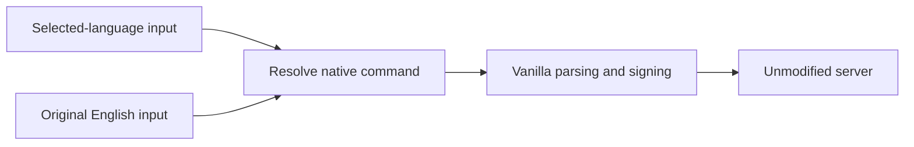

# Command Translation

[简体中文](README.md) | [Compatibility Wiki](https://github.com/kltyton/CommandTranslation/wiki) | [Report an issue](https://github.com/kltyton/CommandTranslation/issues)

**Use Minecraft commands in your language. Keep the original English commands.**

Command Translation is a client-side mod for localized command input, translated resource search and contextual tooltips. Use commands, fixed values, resource names, tags and documented structured fields in your selected language. The server does not need the mod: localized tokens are resolved before vanilla parsing and signing, while English commands and IDs remain available.

## Examples

```mcfunction
/give @s minecraft:stone 1
/我的世界:给予 @s 我的世界:石头 1
/locate biome 我的世界:平原
```

Chinese is an example; input and tooltips follow the selected game language. English commands and native IDs remain available. Player names, coordinates, messages and arbitrary custom data keep their original meaning.

## Features

| Feature | Description |
| --- | --- |
| Localized commands | Use translated command names, fixed options and recognized arguments. English and localized completions stay available together. |
| Resource search | Search items, blocks, entities, biomes, effects, enchantments and more by translated names, aliases and descriptions, reusing existing mod translations. |
| Contextual help | Tooltips explain the pointed suggestion or entered token, including tags, NBT and component keys and values. |
| Syntax and parameters | Native syntax keeps its English tokens, with current-language annotations and smaller parameter panels. |
| Native details | Item tooltips use native attribute text. Entity details start with health, attack damage, movement speed and armor, with individual switches. |
| Resource-pack extensions | Add names, aliases and descriptions through ordinary language files without duplicating a mod's item dictionary. |
| Translation export | Generate English references and a target-language resource pack for missing mod-command translations. |

Localized names include namespaces. Conflicts append the complete original ID, for example `Create:Large Cogwheel(create:large_cogwheel)`; the disambiguated form also works as input.

[NBT Autocomplete](https://modrinth.com/mod/nbt-autocomplete) is bundled for component and NBT keys, nested fields and values, including legacy item NBT. Its completion settings remain independent. Usage and tag descriptions come from Minecraft Wiki or official loader sources; no Wiki connection is needed in-game.



## Installation and versions

Choose the JAR for your Minecraft version and loader, then place it in the client's `mods` folder. Fabric requires Fabric API. NBT Autocomplete is bundled and does not need a separate installation. Mod Menu provides the configuration entry on Fabric.

| Minecraft | Loaders | Java |
| --- | --- | --- |
| 1.20.1 | Forge, Fabric | 17 |
| 1.21.1 | NeoForge, Fabric | 21 |
| 26.1.2 | NeoForge, Fabric | 25 |
| 26.2 | NeoForge, Fabric | 25 |

Fabric Loader 0.19.5 or later is required.

UI, fixed argument aliases and Wiki help are provided in English, Simplified Chinese, Traditional Chinese (Taiwan/Hong Kong), German and Japanese. Other bundled languages provide the available upstream identifier entries and root command aliases; missing entries use vanilla's English fallback. Resource packs may override or extend the files under `assets/command_translation/lang`.

## Configuration

Open the configuration button in the Forge / NeoForge mod list, or in Mod Menu on Fabric. The native settings pages provide feature switches, 16 colors and text formatting. Saving applies the changes immediately and preserves unknown configuration fields.

Manual changes to `config/command_translation.json` take effect after a restart. Feature switches are enabled by default; entity details start with four common attributes. `enabled` is the master switch; `localizedInput`, `identifierTranslation` and `descriptionSearch` control localized input, names and additional description search. `usageTooltips` controls this mod's descriptions and resource details.

| Switch | Controls |
| --- | --- |
| suggestionTooltips | Added completion tooltips; native provider tooltips remain when disabled |
| inputTooltips | Tooltips over entered tokens |
| commandSyntax | Original English syntax |
| syntaxAnnotations | Current-language annotations |
| parameterTooltips | Separate parameter panels |
| compactParameterTooltips | Smaller subsidiary panels |
| structuredTooltips | NBT, component, selector and block-state fields |
| valueTooltips | Argument and structured-value descriptions |
| tagTooltips | Tag meanings |
| itemTooltips | Native item descriptions and attribute text |
| entityTooltips | Registered default attributes of entity types |
| effectTooltips | Brief status-effect descriptions |
| translationExport | Client-side translation resource export command |

NBT Autocomplete retains its separate completion settings.

`entityAttributes` enables `max_health`, `attack_damage`, `movement_speed` and `armor` by default. `attack_speed`, `armor_toughness`, `knockback_resistance`, `attack_knockback`, `follow_range` and `flying_speed` start disabled and can be enabled individually. Short Minecraft keys work with both legacy `generic.` IDs and modern IDs. Full attribute IDs, including modded IDs, may be added and take priority. `otherEntityAttributes` defaults to `false` and controls remaining registered attributes. Existing configuration values are preserved when defaults change.

Only attributes present in the entity type's registered supplier are shown. Values are defaults, not live entity state; movement speed uses native attribute units, not blocks per second.

`identifierStyle` and `tagStyle` support a decimal RGB `color`, `obfuscated`, `bold`, `strikethrough`, `underlined`, `italic`, and `showIdentifierOnHover`.

Alias keys include `command_translation.command.give.alias`, scoped `command_translation.literal.execute.if.alias`, and `command_translation.value.creative.alias`. Separate synonyms with `|`; aliases cannot contain whitespace. Ambiguous aliases do not replace English tokens.

Since 0.2.0, run `/command_translation export` to export missing mod-command entries for the current language. `/command_translation export create` filters by namespace or original command root. The ZIP is written to the current game's `resourcepacks` directory without enabling it. See [Export and Translate](https://github.com/kltyton/CommandTranslation/wiki/Export-en-US) for the short workflow and translation prompt; manual setup remains available.

Parameter descriptions use `command_translation.help.argument.<full node path>`; value descriptions use `command_translation.help.value.<full node path>.<canonical value>`. The item count in give uses `give.targets.item.count`. Parser-specific fixed values use `command_translation.help.value.type.<vanilla parser ID>.<canonical value>`.

Item components use `command_translation.help.component.<namespace:component>`, with `.field.<field path>` appended for nested fields; array indices are omitted. Selector options and block-state properties use `command_translation.help.selector.field.<option>` and `command_translation.help.block_state.field.<property>`. A block-specific meaning can use `command_translation.help.block_state.<block ID>.field.<property>`.

Append `.value.<canonical value>` for a specific field value. Registry values can share `command_translation.help.registry.<registry ID>.<resource ID>` descriptions. The [tooltip language interface](docs/dev/tooltip-resources.md) documents registry bindings, reusable value types, wildcard paths and name overrides using ordinary language files without Java changes.

Tag names use `command_translation.tag.<registry>.<namespace>.<path>`, such as `command_translation.tag.worldgen.biome.minecraft.is_river`. Replace slashes in registry and tag paths with dots. Legacy `command_translation.tag.<namespace>.<path>` keys remain supported.

Item and block names reuse the mod's existing names and resource-pack translations without duplicate entries. Namespace names use `command_translation.namespace.<modid>`, `modmenu.nameTranslation.<modid>`, then `<modid>.ponder.mod_name`; the raw modid is retained when no translation exists. A pack may supply one namespace entry instead of a separate item dictionary.

## Attribution

Code is licensed under LGPL-3.0-only. Identifier dictionaries derive from [Identifier Translation](https://github.com/Yeah-Zero/Identifier-Translation/tree/6bda4a11d30005697e82ea9043e7d486652542b9), under LGPL.

The bundled NBT Autocomplete is developed by mt1006 and contributors under LGPL-3.0-only. Its original packages, metadata and license are retained; see `licenses/nbt-autocomplete.txt`.

Command help and vanilla tag meanings contain excerpts, summaries and translations of [Minecraft Wiki](https://minecraft.wiki/w/Commands) content under CC BY-NC-SA 3.0. Loader tag names also use Fabric API and NeoForge resources, retaining their Apache-2.0 and LGPL-2.1 notices. Page URLs, revisions, loader resource versions and license details are bundled in `assets/command_translation/documentation/sources.json`. Template MIT notices are retained in `licenses/template-MIT.txt`.
