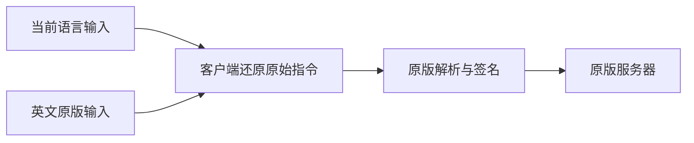

# 指令翻译

[English](README.en.md) | [兼容 Wiki](https://github.com/kltyton/CommandTranslation/wiki) | [问题反馈](https://github.com/kltyton/CommandTranslation/issues)

**用自己的语言输入 Minecraft 指令，英文原版照常可用。**

指令翻译是一个客户端模组，为命令、参数和资源 ID 提供本地化输入、搜索及悬停说明。服务器无需安装；发送前还原为原始指令，权限判断、参数解析和聊天签名仍由原版处理。

## 使用示例

```mcfunction
/give @s minecraft:stone 1
/我的世界:给予 @s 我的世界:石头 1
/locate biome 我的世界:平原
```

中文只是示例，输入和提示跟随当前游戏语言。英文命令和原始 ID 始终保留；玩家名、坐标、聊天正文及任意自定义数据保持原义。

## 功能

| 功能 | 说明 |
| --- | --- |
| 多语言指令 | 命令名、固定选项和可识别参数支持本地化输入，补全列表同时保留英文与当前语言。 |
| 资源搜索 | 按译名、别名和说明查找物品、方块、生物、群系、效果、附魔等；优先复用模组已有翻译。 |
| 悬停说明 | 指向哪一项就解释哪一项，覆盖补全列表、已输入内容、标签、NBT 和组件的键及值。 |
| 语法与参数 | 显示原版语法与本地语言小字标注，相关参数在较小的独立框中解释。 |
| 原版详情 | 物品使用原版属性说明；生物默认展示生命值、攻击伤害、移动速度和护甲值，可逐项配置。 |
| 资源包扩展 | 通过原版语言文件补充译名、别名和具体说明，无需为每个模组物品重建词典。 |
| 翻译导出 | 一键生成未翻译模组命令的英文底稿与目标语言资源包。 |

本地化名称保留命名空间；同名时追加完整原始 ID，例如 `机械动力:大齿轮(create:large_cogwheel)`，消歧形式同样可输入。

随包提供 [NBT Autocomplete](https://modrinth.com/mod/nbt-autocomplete)，支持数据组件、NBT 键、嵌套字段和值补全，包括旧版物品 NBT。其补全选项保持独立配置。用法和标签说明依据 Minecraft Wiki 或加载器官方资料，运行时无需联网。



## 安装与版本

选择对应 Minecraft 版本和加载器的 JAR，放入客户端的 `mods` 文件夹。Fabric 需要另装 Fabric API；NBT Autocomplete 已随包提供，无需另装。安装 Mod Menu 后，Fabric 也可从模组列表进入配置页面。

| Minecraft | Loader | Java |
| --- | --- | --- |
| 1.20.1 | Forge / Fabric | 17 |
| 1.21.1 | NeoForge / Fabric | 21 |
| 26.1.2 | NeoForge / Fabric | 25 |
| 26.2 | NeoForge / Fabric | 25 |

Fabric Loader 最低版本为 0.19.5。

界面、固定参数及 Wiki 说明提供简体中文、繁体中文（台湾/香港）、English、德语和日语。另收录上游其他语言的标识符词条及根命令别名，缺少的词条按原版机制回退英文。显示语言跟随 Minecraft 的语言设置，资源包可以覆盖或补充翻译。

## 配置

通过 Forge / NeoForge 的模组列表配置按钮打开设置；Fabric 安装 Mod Menu 后，可从对应配置按钮进入。设置页包含功能开关、16 种颜色及文字样式，保存后立即生效。

首次启动生成 `config/command_translation.json`。手动修改文件后重新启动游戏。界面保存会保留文件中未知的配置字段。

| 字段 | 默认值 | 作用 |
| --- | --- | --- |
| enabled | true | 总开关 |
| localizedInput | true | 聊天栏本地化输入及别名补全 |
| identifierTranslation | true | 标识符译名及对应指令反馈 |
| usageTooltips | true | 指令和参数的用法说明 |
| suggestionTooltips | true | 补全候选的本项目提示，关闭后保留原有提示 |
| inputTooltips | true | 已输入内容的悬停提示 |
| commandSyntax | true | 原版英文语法 |
| syntaxAnnotations | true | 语法上方的当前语言小字 |
| parameterTooltips | true | 独立参数提示框 |
| compactParameterTooltips | true | 缩小附属参数框 |
| structuredTooltips | true | NBT、组件、选择器及方块状态内部字段提示 |
| valueTooltips | true | 具体参数值及结构化值的说明 |
| tagTooltips | true | 标签含义提示 |
| itemTooltips | true | 原版物品属性及说明文本 |
| entityTooltips | true | 生物类型的默认属性详情 |
| entityAttributes | 生命值、攻击伤害、移动速度、护甲值开启 | 逐属性控制生物详情 |
| otherEntityAttributes | false | 其余已注册且该生物实际具有的属性 |
| effectTooltips | true | 状态效果简介 |
| descriptionSearch | true | 将解释文字额外纳入搜索与完整别名识别 |
| translationExport | true | 客户端翻译资源导出指令 |
| identifierStyle | 青色 | 标识符译名样式 |
| tagStyle | 金色 | 标签译名样式 |

两种样式均包含 `color`（十进制 RGB）、`obfuscated`、`bold`、`strikethrough`、`underlined`、`italic` 和 `showIdentifierOnHover`。英文输入不受本地化输入开关影响。

功能总开关默认开启；生物详情默认只展示四项常用属性。`usageTooltips` 控制本项目的说明及详情，其他提示开关在其下细分；`suggestionTooltips` 与 `inputTooltips` 分别控制两个悬停入口。NBT Autocomplete 的补全设置仍使用它自己的配置文件。

`entityAttributes` 默认启用 `max_health`、`attack_damage`、`movement_speed` 和 `armor`。`attack_speed`、`armor_toughness`、`knockback_resistance`、`attack_knockback`、`follow_range` 和 `flying_speed` 默认关闭，可分别改为 `true`。这些短键同时适配旧版的 `generic.` 前缀和新版 ID。还可添加完整属性 ID（如 `example:focus`），完整 ID 优先于短键；未单独设置的属性由 `otherEntityAttributes` 控制。已有配置保留原设置，不会被新的默认值覆盖。

只显示该生物已注册的属性，不为不存在的攻击力等属性编造数值。数值是属性系统的默认值，并非某个已生成实体的实时状态；移动速度保留原版属性单位，不换算为每秒方块数。

## 翻译资源

0.2.0 起，可执行 `/command_translation export` 导出当前语言缺少的模组命令条目；`/command_translation export create` 可按命名空间或原命令根筛选。ZIP 写入当前游戏目录的 `resourcepacks`，不会自动启用。翻译步骤和推荐提示词见[快速接入](https://github.com/kltyton/CommandTranslation/wiki/Export-zh-CN)，手动接入文档仍保留。

翻译使用原版语言系统，位于 `assets/command_translation/lang/<locale>.json`。别名可用 `|` 分隔多个写法，不包含空格。

```json
{
  "command_translation.command.give.alias": "给予|给",
  "command_translation.literal.execute.if.alias": "如果",
  "command_translation.value.creative.alias": "创造",
  "command_translation.help.command.give": "给予玩家物品。"
}
```

自定义模组的群系、效果和附魔优先读取其原有翻译键。其他标识符可提供 `command_translation.structure.<namespace>.<path>`、`command_translation.poi.<namespace>.<path>` 或 `command_translation.configured_feature.<namespace>.<path>`。标签使用 `command_translation.tag.<registry>.<namespace>.<path>`，例如 `command_translation.tag.worldgen.biome.minecraft.is_river`；注册表及资源路径中的斜线换成点。旧的 `command_translation.tag.<namespace>.<path>` 仍可使用。

物品和方块直接复用模组或资源包提供的实际名称，无需逐项新增词条，例如“机械动力:大齿轮”。命名空间依次读取 `command_translation.namespace.<modid>`、`modmenu.nameTranslation.<modid>`、`<modid>.ponder.mod_name`，缺少译名时保留 modid。整合包只需按需补充一个命名空间名称，而非重建物品词典。

药水、状态效果和附魔也读取注册对象的原生名称或描述组件，保留模组自定义的翻译键；同名药水变体仍按完整原始 ID 消歧。

参数说明使用 `command_translation.help.argument.<完整节点路径>`，候选值说明使用 `command_translation.help.value.<完整节点路径>.<原始值>`。例如给予数量的节点路径为 `give.targets.item.count`。原生参数类型的固定值说明使用 `command_translation.help.value.type.<原版参数类型 ID>.<原始值>`。

物品组件使用 `command_translation.help.component.<命名空间:组件名>`，内部字段在后面追加 `.field.<字段路径>`，数组下标不计入路径。选择器和方块状态分别使用 `command_translation.help.selector.field.<选项>` 与 `command_translation.help.block_state.field.<属性>`。同名属性可用 `command_translation.help.block_state.<方块 ID>.field.<属性>` 提供专门说明。

具体值在对应字段键后追加 `.value.<原始值>`；注册表资源值可以统一使用 `command_translation.help.registry.<注册表 ID>.<资源 ID>`。字段的注册表、共用枚举值类型、通配路径及名称覆盖见[提示语言接口](docs/dev/tooltip-resources.md)，只需原版语言文件，无须修改 Java。

## 来源与许可

代码采用 LGPL-3.0-only。标识符词条参考 [Identifier Translation](https://github.com/Yeah-Zero/Identifier-Translation/tree/6bda4a11d30005697e82ea9043e7d486652542b9)，保留其 LGPL 许可。

随包的 NBT Autocomplete 由 mt1006 及贡献者开发，采用 LGPL-3.0-only；保留其原始包名、元数据和许可，说明见 `licenses/nbt-autocomplete.txt`。

用法说明与原版标签含义节选、概括并翻译自 [Minecraft Wiki](https://minecraft.wiki/w/Commands)，相应词条遵循 CC BY-NC-SA 3.0。Loader 标签译名参考 Fabric API 与 NeoForge，分别保留 Apache-2.0 和 LGPL-2.1 许可。原始页面、修订号、Loader 资源版本和许可记录随 JAR 的 `assets/command_translation/documentation/sources.json` 提供。模板及其来源的 MIT 声明见 `licenses/template-MIT.txt`。
