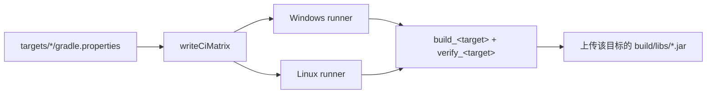

# CI

根 writeCiMatrix 读取目标 gradle.properties，输出启用目标的 Windows/Linux 矩阵。不额外维护 ci.properties，不调用 Python。

CI 只运行原生目标 build_<id> 与 verify_<id>，安装所需 JDK，并检查实际 JAR。没有空 common test job、默认 clean 或盲目重试；没有客户端或模组平台上传。

工作流使用 checkout v7、setup-java v5、setup-gradle v6 和 upload-artifact v7。矩阵继续来自目标配置，同一目标分别使用 Windows/Linux 托管 runner，编译 Java 与 Gradle Java 按目标声明安装。

本地输出与 CI 结论分别绑定实际目标和场景。未实际运行 Actions 时只报告工作流已配置。
