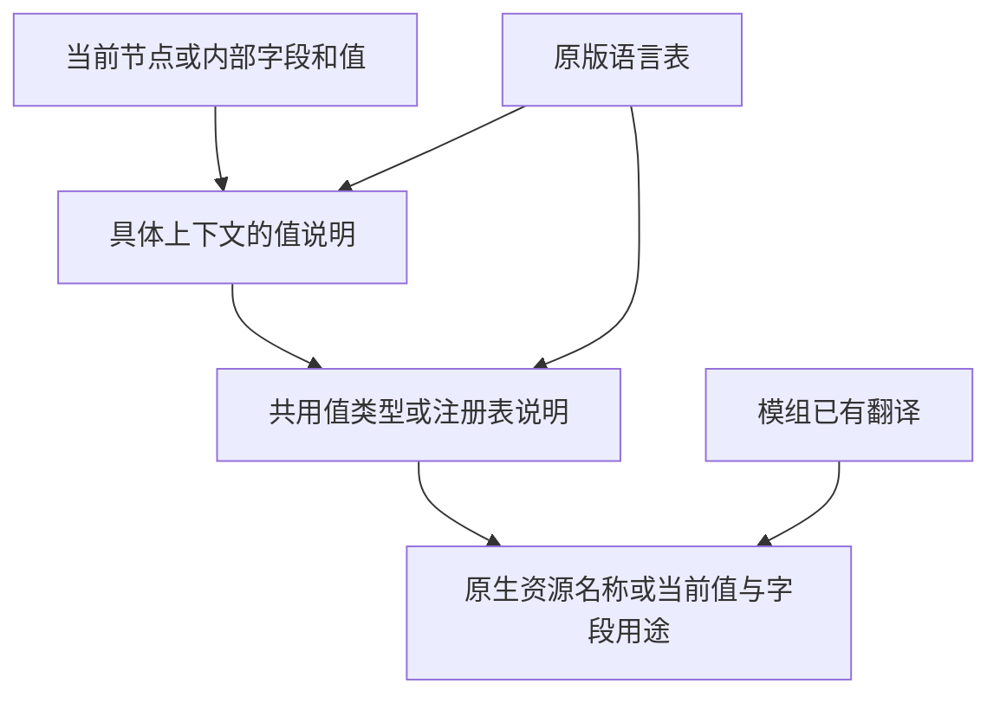
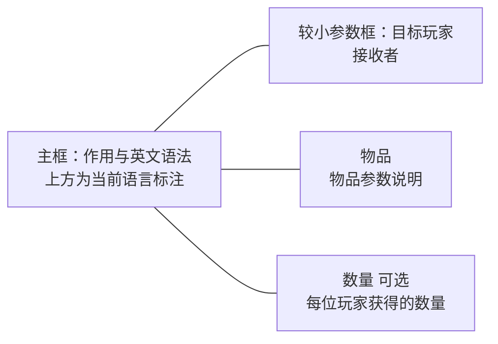

# 提示语言接口

提示使用 Minecraft 原版语言表。资源包可在 `assets/command_translation/lang/<locale>.json` 中添加键；模组也可把相同的键放入自己的语言文件。语言随游戏设置变化，缺项遵循原版英文回退。普通物品、方块、实体和已有标识符名称继续复用原生翻译，无需复制整套名称。

补全候选和已输入的字段共用值说明规则。英文原始形式始终保留；新增译名不会替换原版候选。



## 命令参数

| 用途 | 键 |
| --- | --- |
| 命令 | `command_translation.help.command.<命令名>` |
| 参数 | `command_translation.help.argument.<完整节点路径>` |
| 参数具体值 | `command_translation.help.value.<完整节点路径>.<原始值>` |
| 原生参数类型的值 | `command_translation.help.value.type.<参数类型 ID>.<原始值>` |
| 无原生注册表信息的参数绑定 | `command_translation.help.argument.<完整节点路径>.registry` |

节点路径使用原始节点名，以点连接，例如 `give.targets.item.count`。参数绑定的值是注册表 ID，不是翻译后的文本。原生参数类型或补全提供者已经给出注册表时，无需重复绑定。

## 结构化字段

字段族包括 `component.<组件 ID>`、`nbt.entity`、`nbt.item`、`nbt.block_entity`、`selector`、`block_state`、`text`、`dialog` 和 `particle.<粒子 ID>`。以下各项均以 `command_translation.help.` 开头。

| 用途 | 后续键路径 |
| --- | --- |
| 组件本身 | `component.<组件 ID>` |
| 组件直接值 | `component.<组件 ID>.value.<原始值>` |
| 字段用途 | `<字段族>.field.<字段路径>` |
| 字段具体值 | `<字段族>.field.<字段路径>.value.<原始值>` |
| 字段值的注册表 | `<字段族>.field.<字段路径>.registry` |
| 字典键的注册表 | `<字段族>.field.<字段路径>.key_registry` |
| 共用值类型 | `<字段族>.field.<字段路径>.value_type` |
| 共用类型中的具体值 | `value.type.<类型名>.<原始值>` |

组件直接值的 `.registry`、`.value_type` 追加在组件键后，不含 `.field`。注册表绑定和值类型名保留代码中的原始写法，不随语言翻译。字典键绑定用于附魔等以资源 ID 作为键的结构。

代码绑定建议放入 `en_us.json`，其他语言只补充实际文案；原版语言系统会将未覆盖的语言回退到英文表中的相同绑定，不必逐语言复制代码 ID。

数组下标不计入路径。字段路径可用 `*` 匹配一个成员。查询先取精确路径，再从右到左尝试单成员通配，最后尝试连续的尾部成员通配；不是任意深度递归匹配。具体字段值词条优先于 `.value_type`，因此一个字段可以覆盖共用枚举的默认说明。

```json
{
  "command_translation.help.component.minecraft:damage_type.registry": "minecraft:damage_type",
  "command_translation.help.registry.minecraft:damage_type.minecraft:arrow": "箭矢命中造成的伤害。",
  "command_translation.registry.minecraft:damage_type.minecraft:arrow.name": "箭矢",
  "command_translation.help.component.minecraft:attribute_modifiers.field.operation.value_type": "attribute_operation",
  "command_translation.help.value.type.attribute_operation.add_value": "直接加上修饰数值。",
  "command_translation.help.component.example:device.field.rules.*.value.true": "该条规则启用时的具体效果。"
}
```

最后一项演示自定义组件的通配路径，实际项目应使用自己的组件 ID 和有依据的说明。

## 注册表名称与说明

注册表和值都使用完整 ID，保留冒号和路径中的斜线，不将两个注册表的同名资源合并。

```json
{
  "command_translation.namespace.example": "示例模组",
  "command_translation.registry.example:mode.example:quiet.name": "安静",
  "command_translation.help.registry.example:mode.example:quiet": "该模式的具体含义。",
  "command_translation.help.component.example:device.field.mode.registry": "example:mode"
}
```

名称词条只在需要补充或明确覆盖名称时添加。既有物品、方块和实体名称不要求新增本项目条目。命名空间名称和重名原始 ID 标注仍按项目统一规则处理。

有命名空间的命令直接使用其原始 ID 中的命名空间。未显式命名空间的模组命令可用 `command_translation.command.<根命令名>.namespace` 声明所属 modid，值保留代码写法，例如 `create`；无需从回调类名推测归属。译名仍使用对应的命名空间名称词条。

注册表说明可以在普通命令参数、组件值和 NBT 字段之间复用。具体字段值词条可覆盖同一注册表值在某个上下文中的说明。不能仅凭同名字符串推测注册表：自由文本或自定义数据没有明确绑定时保持原义。

## 语法标注与参数框

原版语法由当前命令树的 `Brigadier#getSmartUsage` 生成，保留 `<>`、`[]`、分支和重定向标记，不从翻译文件重写英文语法。命令和字面子命令标注复用现有别名；参数标注先读取 `command_translation.syntax.argument.<完整节点路径>`，再读取 `command_translation.syntax.argument.<参数名>`。

```json
{
  "command_translation.syntax.argument.give.targets": "目标玩家",
  "command_translation.syntax.argument.item": "物品",
  "command_translation.syntax.argument.count": "数量",
  "command_translation.help.argument.give.targets": "接收物品的玩家。",
  "command_translation.help.argument.give.item": "要给予的物品。",
  "command_translation.help.argument.give.count": "每位目标玩家获得的物品数量。"
}
```

参数框使用相同的参数说明键。单一路径上的参数分别展示；出现分支时，显示当前层级的参数，分支继续部分可在对应子命令或实际参数上查看。选择器使用原版短译名，具体用途在指向该选择器时显示，不在每个参数框重复列举。指向具体字段或值时不会展开外层命令的语法面板。



语法标注使用固定比例小字。附属参数框默认使用 80% 字号、较窄宽度，并在主框侧边排列。背景、字体和提示事件继续通过对应版本的原版 tooltip 渲染流程。

## 资源详情

物品候选和已输入物品使用原版 `Screen#getTooltipFromItem` 生成属性与说明文本，保留相应物品说明回调。只有实际显示的物品才生成详情；有效 NBT 或组件由对应版本的原版物品解析器读取，尚未写完或无效的数据不伪造属性。生物类型读取注册的默认属性，不实例化生物；属性名直接复用属性对象的原版翻译键，整合包无需另建名称条目，可通过配置按完整属性 ID 覆盖显示开关。效果简介仍使用 `command_translation.help.registry.minecraft:mob_effect.<效果 ID>`，模组作者可在自己的语言文件中补充；名称继续复用原有翻译。

各提示类别可在配置文件中独立关闭，字段和默认值见 [配置](../../README.md#配置)。关闭本项目提示不会移除原版或第三方已提供的提示。

## 文案与来源

每个词条解释当前命令、参数、字段或值，使用简短语句，不堆叠外层用法教程。原版内容依据 Minecraft Wiki；Loader 标签依据对应官方资料。模组自定义内容由其作者提供说明。发布资源包时应保留所使用资料要求的署名和许可。

本项目内置资料保存在 `tools/localization/sources/parameters`，对应来源随发行包的 `assets/command_translation/documentation/sources.json` 提供。资源包扩展不需要运行生成器或增加运行时依赖。
